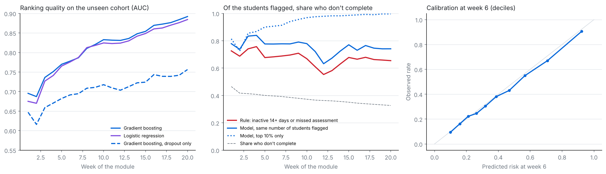

# Student early warning

**Which students, still enrolled at week *n*, are at risk of not completing their module, and why?**

This is an evaluated prototype of an engagement-based early-warning model. It uses the Open University Learning Analytics Dataset (OULAD): 32,593 student enrolments on 7 modules, 10.6 million daily learning-platform activity records, and 174,000 assessment submissions. It was built to test the questions an engagement-analytics product has to answer:

- Can behaviour data identify students at risk early enough to act on?
- Does a model beat the simple rules that dashboards already use?
- Are the risk scores trustworthy (calibrated, fair, explained)?
- What breaks when the course changes?



## Set-up

- **Checkpoints.** Every week, from week 1 to week 20, the model scores every student who is **still registered**. Students who have already left are excluded, because flagging them is pointless.
- **No future data.** Features use only data dated up to the checkpoint. A test changes the future (more activity, late submissions, higher marks) and checks that no feature moves. I also checked that this test fails when the date filter is removed.
- **Unseen cohort.** The model is trained on three earlier presentations (2013B, 2013J and 2014B) and tested on the latest one, 2014J: 9,757 students it has never seen. This is how such a model would be used in practice.
- **Targets.**
  - Main target: **not completing**, meaning the student withdraws or fails.
  - Secondary target: **dropout**, meaning the student withdraws.
- **Capacity.** A support team cannot contact everyone. I report results for "contact the top 10% each week" and for "flag as many students as the rule does".

### Features

Each feature is an observable signal for an aspect of engagement:

| Aspect | Signals |
|---|---|
| Behavioural engagement | Activity volume, active days, weeks active, regularity |
| Disengagement | Days since last activity, activity in the last 14 days compared with the 14 days before |
| Academic engagement | Assessments due, submitted, missed and late; marks so far |
| Breadth | Number of types of learning material used; forum, quiz and content share |
| Context | How early the student registered |

Activity is also expressed as a **percentile within the cohort**, because modules differ hugely in how much online material they have. Demographics are left out by default; the fairness section explains why.

## Results on the unseen cohort (week 6)

The first table is for the main target, **not completing**. At week 6, 40% of the students still registered go on to withdraw or fail.

| Method | AUC | Precision, top 10% | Precision at the rule's volume (22% flagged) |
|---|---|---|---|
| Rule: inactive 14+ days or missed an assessment | – | – | 0.68 |
| Logistic regression | 0.776 | 0.91 | 0.77 |
| Gradient boosting (LightGBM) | **0.778** | **0.91** | **0.78** |
| Gradient boosting + demographics | 0.786 | 0.92 | 0.78 |

The confidence intervals below come from a paired bootstrap over students.

- **The model beats the rule.** When both flag the same number of students, the model's list has 9.4 points more students who really don't complete (95% CI 7.5 to 11.1). At the top 10%, 91% of flagged students go on to withdraw or fail.
- **A simple model is enough.** Gradient boosting is no better than logistic regression (PR-AUC +0.003, CI −0.003 to +0.009). In production I would start with the logistic model, because it is easier to explain and maintain.
- **Early is harder.** AUC rises from 0.69 in week 2 to 0.78 in week 6 and 0.87 in week 16. The model has the least to go on exactly when an intervention is cheapest.
- **The probabilities can be read as probabilities.** Across deciles at week 6, predicted and observed rates differ by at most 4 points.

### Dropout alone is much harder to predict

| Week 6, target = dropout (18% base rate) | AUC | Precision, top 10% | Precision at the rule's volume |
|---|---|---|---|
| Rule | – | – | 0.32 |
| Logistic regression | 0.701 | 0.48 | 0.36 |
| Gradient boosting | 0.691 | 0.44 | 0.35 |

- **Precision.** At the same volume, the model is only 3 points more precise than the rule (CI 1.2 to 5.0).
- **Lead time.** Across weeks 2–20, I flagged the same number of students as the rule each week:
  - The rule catches **62%** of students who drop out before they leave, with a median warning of **20 days**.
  - The model catches **59%**, with a median warning of **25 days**.

  Many students who drop out show no clear warning sign in platform activity or marks before they leave, which suggests their reasons lie outside the platform. This is where survey or pastoral data would add value.

## What drives the score

These are the mean absolute contributions at week 6, in log-odds:

| Signal | Contribution |
|---|---|
| Assessments missed | 0.51 |
| Average mark so far | 0.49 |
| Week of the module | 0.24 |
| Days since last activity | 0.20 |
| Active days, as a percentile in the cohort | 0.19 |
| Activity, as a percentile in the cohort | 0.14 |

Each flag comes with up to two reasons, built from the student's own feature contributions. A reason is shown only if it is actually concerning; for example, a score of 85% is never shown as a risk factor. A test checks this. Real examples from the test cohort:

| Risk | Reasons shown | Outcome |
|---|---|---|
| 0.96 | 1 assessment not submitted; no learning-platform activity for 68 days | did not complete |
| 0.92 | average assessment score 44%; fewer active days than 84% of the cohort | did not complete |
| 0.84 | less active than 95% of the cohort; fewer active days than 98% of the cohort | **completed** |

The last example is the kind of case a human should review: low online activity is not always disengagement. Some students may study offline, for example from printed material.

## A course change that breaks the model, and a check that catches it

Module BBB performed much worse in the test cohort (AUC 0.63). I traced this to a course redesign. In 2014J, BBB's first assignment was changed from 5% of the grade to **0%**, and **41%** of its submissions were marked 0–1%. In every other assessment in the data, fewer than 3.2% are. The model read these placeholder marks as failing students.

I added a general run-time check. When more than 20% of an assessment's submitted marks are 0–1%, the submission still counts, but the marks are ignored. The check only uses marks that are already in, so it works on live data. In the full data it fires on exactly one assessment. The next-highest share is 3.1%.

| Week 6 | Without check | With check |
|---|---|---|
| AUC, all modules | 0.754 | **0.778** |
| AUC, module BBB | 0.628 | **0.688** |
| BBB average predicted risk (actual rate: 0.35) | 0.54 | 0.43 |

To be transparent: I found this by investigating poor test results, so this is a diagnosed failure, not a blind gain. The general lesson for a product deployed across many institutions is that changes to course and assessment design move the data under the model. Simple distribution checks on incoming data are worth more than extra model complexity.

## Fairness

Demographics are excluded by default for three reasons:

- They add little: PR-AUC rises by 0.009 (CI 0.004 to 0.013).
- They tie a student's risk to who they are rather than what they do.
- An intervention list built on them is harder to defend.

For the behaviour-only model, with the top 10% flagged at week 6:

| Group | Base rate | Share flagged | Recall | Precision |
|---|---|---|---|---|
| Most deprived 30% (IMD) | 0.47 | 0.12 | 0.24 | 0.94 |
| Least deprived 30% | 0.35 | 0.09 | 0.23 | 0.89 |
| Disability declared | 0.52 | 0.14 | 0.25 | 0.94 |
| No disability declared | 0.38 | 0.10 | 0.23 | 0.90 |
| Women | 0.38 | 0.08 | **0.19** | 0.87 |
| Men | 0.41 | 0.12 | **0.26** | 0.93 |

Flag rates follow each group's real risk, and precision is similar across groups. There is one gap. Women who go on to withdraw or fail are less likely to be flagged than men: recall is 0.19 against 0.26. Their disengagement seems less visible in platform activity. This should be monitored, and the threshold or the features reviewed with the institution. The full tables are in `results/fairness.csv`.

## Limits

- **Old data.** The data is from one university (the Open University, distance learning) in 2013–2014. Campus students, e-textbook reading and attendance data would behave differently.
- **One test cohort.** There is a single test presentation, and module mixes differ between presentations.
- **Prediction only.** The model predicts risk; it does not show that contacting a student helps. Measuring that needs an intervention trial.
- **No tuning.** Hyperparameters are fixed and were not tuned on the test set. Feature variants were compared on 2014B only, and none beat the basic set.

## Run it

```bash
pip install -r requirements.txt
python scripts/get_data.py     # OULAD from the dataset authors' package (CC BY 4.0), pinned commit
python -m pytest -q tests      # 8 tests on synthetic data, including the future-data check
python evaluate.py             # about 3 minutes; writes results/
python plot.py
```

GitHub Actions runs the tests and the full evaluation on every push.

**Data:** Kuzilek J., Hlosta M., Zdrahal Z. *Open University Learning Analytics dataset.* Scientific Data 4, 170171 (2017). Licence: CC BY 4.0.

---
Kian Shafiei · MSc Applied AI for Engineering (Distinction) · [LinkedIn](https://www.linkedin.com/in/kianshafiei/)
